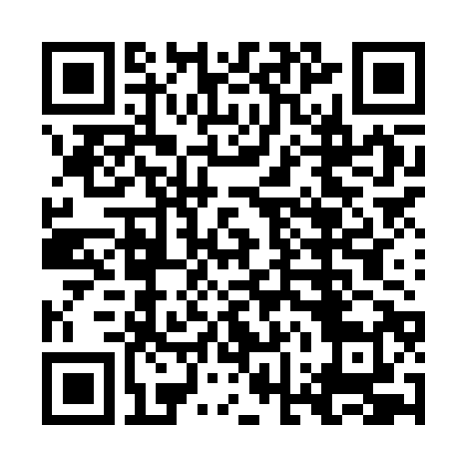
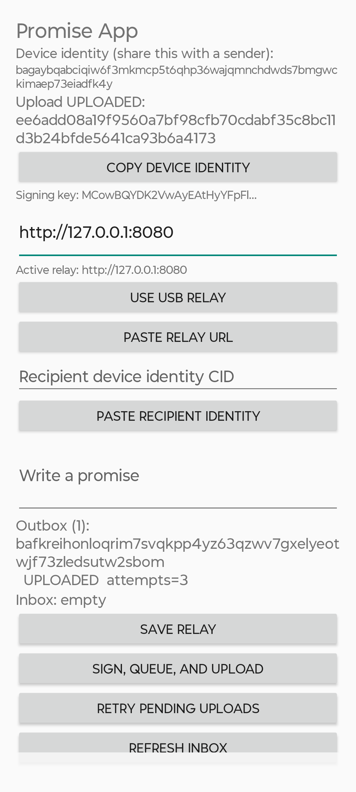

# Example POC: phone signs, relay retains, computer verifies

This record describes one completed local proof on 2026-10-17. It is evidence
for the Android-to-computer POC, not a claim of universal PromiseGrid transport
or a production deployment.

## Claim proved

An Android phone created one immutable, signed Promise Messaging v0 envelope,
persisted and uploaded its exact bytes through the local relay, and a separate
computer-owned recipient identity fetched, verified, and retained those same
bytes.

The frozen POC protocol selector was:

```text
bafkreicutumpjz3skwoehjn3gptve5m3atgypmfbsdhbtapg2rcwt2c2hi
```

The envelope format is the POC-owned, Grid-shaped profile
`grid([42(pCID), payload, proof])`. Its payload and proof rules are defined by
that selector in [Promise Messaging v0](protocols/promise-messaging-v0.md).
The outer Grid shape is current provisional PromiseGrid guidance; it is not a
claim of a frozen universal app API.

## Participants and route

| Role | Observed identity / route |
| --- | --- |
| Phone sender | `bagaybqabciqiw6f3mkmcp5t6qhp36wajqmnchdwds7bmgwckimaep73eiadfk4y` |
| Computer recipient | `bagaybqabciqgtv226wkotkpxy3limnarnfs23ypn6konmtzafcwzs2g3hix3otq` |
| Local relay route | Phone `http://127.0.0.1:8080` through `adb reverse tcp:8080 tcp:8080` |
| Relay health | `{"status":"ok"}` from computer loopback |

USB forwarding was selected after the private-LAN browser route did not reach
the relay. That is a host-specific demo transport choice; it is not part of
the message protocol.

## Recipient identity transfer

The computer recipient CID was rendered as a QR code so it could be scanned or
copied without manually entering a long identifier.



The QR encodes only the computer recipient identity CID shown above. It does
not contain a private key, relay admin token, signed message, or acceptance.

## Exact procedure performed

1. The computer relay was started with persistent local data storage and a
   private audit token. The relay listened on port 8080.
2. The computer confirmed `http://127.0.0.1:8080/healthz` returned
   `{"status":"ok"}`.
3. The Android device was visible to ADB as `ZD222TKJ4S\tdevice`.
4. The command below mapped the phone's loopback port 8080 to the computer's
   relay port over the USB cable:

   ```sh
   adb reverse tcp:8080 tcp:8080
   ```

5. `make usb-relay-status` confirmed both the ADB reverse mapping and relay
   health:

   ```text
   UsbFfs tcp:8080 tcp:8080
   {"status":"ok"}
   ```

6. In Promise App, the phone used the saved relay URL
   `http://127.0.0.1:8080`. The computer recipient CID was transferred by QR
   and placed in the app recipient field.
7. The phone signed and uploaded the body `test`. The relay accepted the exact
   envelope bytes under this message CID:

   ```text
   bafkreihonloqrim7svqkpp4yz63qzwv7gxelyeotwjf73zledsutw2sbom
   ```

### Phone-side evidence

This screenshot was captured from the connected Android device after the
upload. It visibly records the active USB relay URL, the persisted outbox item,
the same message CID, and `UPLOADED attempts=3`. The attempt count reflects
the app's recorded upload attempts; it is not a claim of three distinct
immutable messages.



8. On the computer, `make peer-inbox-local` fetched and independently checked
   the envelope. Its result identified the expected selector, sender,
   recipient, body, and retained file:

   ```json
   {
     "cid":"bafkreihonloqrim7svqkpp4yz63qzwv7gxelyeotwjf73zledsutw2sbom",
     "protocol":"bafkreicutumpjz3skwoehjn3gptve5m3atgypmfbsdhbtapg2rcwt2c2hi",
     "from":"bagaybqabciqiw6f3mkmcp5t6qhp36wajqmnchdwds7bmgwckimaep73eiadfk4y",
     "to":"bagaybqabciqgtv226wkotkpxy3limnarnfs23ypn6konmtzafcwzs2g3hix3otq",
     "kind":"promise_offer",
     "body":"test"
   }
   ```

9. `make evidence-local` performed the retained-evidence check and reported:

   ```text
   PASS cid=bafkreihonloqrim7svqkpp4yz63qzwv7gxelyeotwjf73zledsutw2sbom \
   bytes=342 mailbox_entries=1 uploads=1 fetches=2
   ```

10. The verified exact CBOR bytes were retained at:

    ```text
    .local/promise-peer/inbox/bafkreihonloqrim7svqkpp4yz63qzwv7gxelyeotwjf73zledsutw2sbom.cbor
    ```

    The check output and authenticated relay audit snapshot were retained under
    `.local/promise-evidence/bafkreihonloqrim7svqkpp4yz63qzwv7gxelyeotwjf73zledsutw2sbom/`.
    Those local artifacts are intentionally not committed because they may
    contain environment-specific audit data.

## What the proof means

The computer did not trust a relay JSON summary as the message. It retrieved
the stored bytes and checked the message CID, the frozen pCID selector,
canonical payload/proof structure, Ed25519 signature, and intended recipient
before retaining the CBOR file. The relay stored and returned bytes; it did
not create a promise, accept one, or decide that one was fulfilled.

This fits current PromiseGrid app guidance: the POC names an explicit frozen
protocol selector, leaves payload/proof semantics to that selector, keeps
exact bytes available for later assessment, and treats ingress as an
implementation-specific boundary. The general app surface and universal
envelope API remain provisional under `DR-tuhaz`.

## What remains unproved

- A second physical phone or Kindle recipient.
- Offline queue/restart/retry proof using the same CID.
- Duplicate-upload proof showing the relay reports one immutable object.
- Production TLS, availability, anti-abuse, user identity, key rotation,
  recovery, authorization, or trust policy.
- Recipient acceptance or fulfillment of the promise. Delivery and signature
  verification are evidence, not acceptance.

See [the proof runbook](poc-proof-runbook.md) for the remaining two-device and
offline-retry evidence steps.
